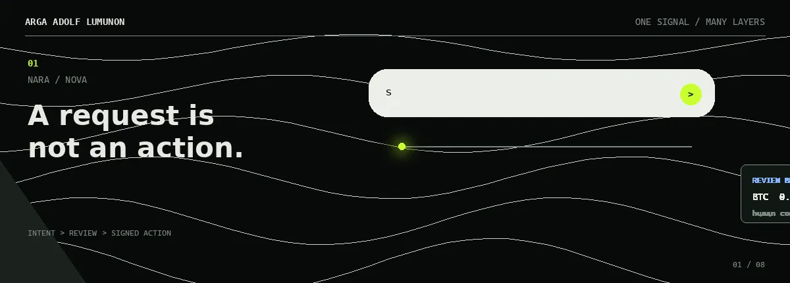

  

  <strong>Software engineer building AI systems, reliable backends, and constrained inference.</strong>
   
  I follow a requirement across layers: service topology, model execution, browser evidence,
  product interfaces, or an input driver. The stack follows the constraint.

## Selected systems

- **Agentic RAG research - retrieval and evaluation.** In a paid research collaboration supporting
  a Telkom University lecturer's dissertation, I contribute authority-aware retrieval and build
  document-grounded QA benchmarks, frozen development/blind splits, citation and abstention scoring,
  and external-system evaluation runners.
- **[Fradium](https://github.com/fradiumofficial/fradium) - WCHL 2025 Fully On-Chain Track
  winner.** I contributed cross-chain transaction-risk analysis,
  Rust/ONNX/Wasm inference, stable model persistence, ICPSwap integration, wallet features, and
  Paylink. The project also placed first in the qualification and Indonesia rounds and second in Asia.
- **[Nara Wallet](https://github.com/ArgaAAL/nara-wallet) - NextGen Agents Hackathon winner.** I
  contributed multi-exchange market-data acquisition, deterministic feature scaling, and
  LightGBM-to-ONNX execution-cost inference for a Wasm-compatible conversational wallet.
- **[SpecHeal](https://github.com/antech2-async/SpecHeal) - Refactory Hackathon 2026 second
  place.** On a two-person team, I built evidence-gated Playwright recovery with DOM and screenshot
  capture, structured AI evaluation, browser rerun proof, patch previews, and audit trails.
- **[Nova AI Wallet](https://github.com/OfficialNovaAI/nova-wallet) - wallet intelligence and agents.**
  I built counterparty/whale analysis, scam filtering, ENS validation and live-data aggregation,
  connecting natural-language requests to wallet actions with transaction previews and human
  confirmation. The team received **1st Notable Mention** and **1st Social Media Challenge** at
  [SEA Lisk Builders Challenge 3](https://bse.telkomuniversity.ac.id/prestasi-tim-nova-ai-di-south-east-asia-lisk-builder-challenge-3/).
- **Marketizen - backend and deployment owner.** I built a Go marketplace as a modular monolith
  with PostgreSQL, RabbitMQ, Redis, PgBouncer, Traefik, and Docker Swarm. A 1,000-virtual-user
  plateau completed 20,320 requests with all 40,640 semantic checks passing at 328.57 ms p95 latency.
- **[PayGate](https://github.com/wildanniam/paygate-stellar) - funded development.** A paid API
  gateway on Stellar testnet, where I implemented persistent payment-state handling and withdrawal
  reconciliation. The project was accepted for a USD 5,000 Stellar Community Fund Instaward.
- **[Nabu A1931 Bridge](https://github.com/ArgaAAL/nabu-a1931-bridge) - shipped compatibility
  work.** I built native Android multitouch and Windows Precision Touchpad support for an A1931
  Bluetooth keyboard case on Xiaomi Pad 5, with public source, guarded packages, checksums, and
  rollback documentation.

## Research, open source and recognition

- **ICoAILO 2026 co-author:** *Authority-Aware Agentic Retrieval-Augmented Generation for Academic
  Regulation Question Answering*, with conference author recognition in October 2026.
- **[AWS Prompt the Planet Challenge 2026](https://dorahacks.io/hackathon/awsprompttheplanet/winner):
  one of ten winners.** My [AWS Secrets Manager Migration Guide](https://dorahacks.io/build/44245)
  received a USD 5,000 AWS Activate credit prize.
- **[FFmpeg upstream contribution](https://github.com/FFmpeg/FFmpeg/commit/c7454d8df7676c9a5ce64b6a4159f292ed0793f6):**
  a merged C fix for DXGI input-buffer handling affecting Qualcomm H.264 encoding on Windows ARM64,
  supported by matched patched/unpatched hardware comparisons.
- **[Dicoding DCML - Machine Learning with TensorFlow](https://www.dicoding.com/certificates/XPV7PGE0Z8):**
  certified July 2025-July 2028; selected among the final ten in the IDCamp ML track for sponsored certification.
- **Software copyright co-creator:** EVASION and EVASION-MAE, alongside the recorded Marketizen work.

## Technical map

- **Retrieval, agents and evaluation:** RAG, tool workflows, document-grounded benchmarks,
  source provenance, citation/abstention scoring, and evidence-gated recovery
- **Applied ML systems:** Python, TensorFlow/TFX, PyTorch, ONNX, LightGBM, XGBoost, graph neural
  networks, and constrained inference
- **Backend and distributed systems:** Go, PostgreSQL, RabbitMQ, Redis, event-driven architecture,
  API gateways, Docker, Kubernetes, and load testing
- **Constrained platforms:** Rust, WebAssembly, Internet Computer, Stellar/EVM, Android input
  systems, Bluetooth HID, UMDF, and Windows on ARM
- **Product and quality:** TypeScript, React/Next.js, Playwright, CI/CD, human confirmation flows,
  interface prototyping, and reproducible validation

## Current edge

- Private self-consistency research separating proposal generation from belief accountability through
  compression, provenance, counterfactuals, sandbox tests, and composition. This remains WIP.

Smaller public experiments cover wallet orchestration, execution-cost prediction, Bitcoin and
Ethereum forensics, and recommendation mechanics. Not every repository needs to pretend it is a product.

---

Bachelor of Software Engineering, Telkom University (2026) | GPA 3.90/4.00 | thesis A 
[LinkedIn](https://www.linkedin.com/in/argaadolflumunon/)

Some projects live in team organizations; every description above is scoped to my contribution.
Earlier work may appear under the <code>gitarRacing</code> identity; <code>ArgaAAL</code> is my current account.

